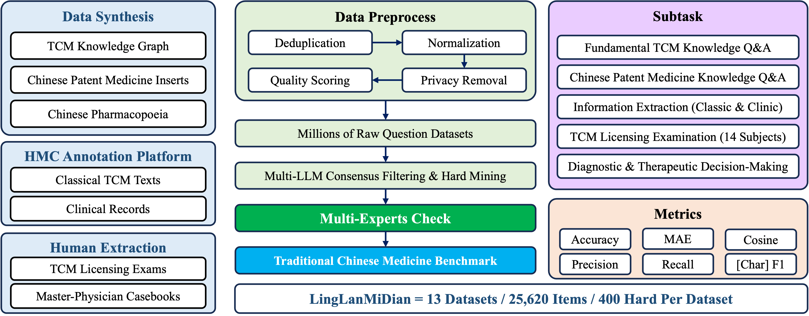
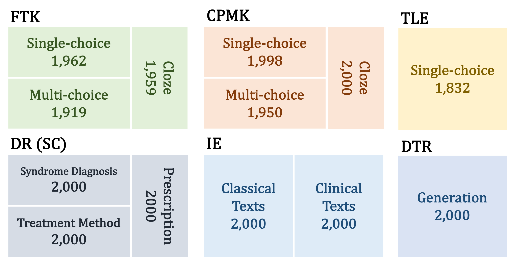

<p align="center">
  
</p>

<h2 align="center">A Unified Benchmark for Evaluating Large Language Models<br />in Traditional Chinese Medicine</h2>

<p align="center">
  <a href="https://arxiv.org/abs/2602.01779"><b>Paper</b></a>&nbsp;·&nbsp;
  <a href="data/README.md"><b>Dataset</b></a>&nbsp;·&nbsp;
  <a href="http://tcmnlp.com"><b>Leaderboard</b></a>&nbsp;·&nbsp;
  <a href="README_zh.md"><b>中文</b></a>
</p>

## Introduction

**LingLan** is an expert-curated benchmark for evaluating large language models (LLMs) across five domains of Traditional Chinese Medicine (TCM): licensing examination, fundamental knowledge, Chinese patent medicine knowledge, information extraction, and diagnostic and therapeutic decision-making. The last domain includes both diagnostic and therapeutic reasoning (DTR) and single-choice decision recognition (DR).

The release includes Full and Hard evaluation sets with reference labels in the `answer` field. See [Data Statistics](#data-statistics) for counts and the [data documentation](data/README.md) for schemas and file details.

---

## Contents

- [What is LingLan](#what-is-linglan)
- [Data Statistics](#data-statistics)
- [Evaluation Metrics](#evaluation-metrics)
- [Download](#download)
- [Quick Start](#quick-start)
- [Leaderboards](#leaderboards)
- [Cite LingLan](#cite-linglan)
- [Data Sources](#data-sources)
- [Data license](#data-license)
- [Acknowledgements](#acknowledgements)

---

## What is LingLan

<p align="center">
  
</p>

LingLan evaluates factual knowledge, structured information extraction, and clinical decision-making through single-choice, multiple-choice, fill-in-the-blank, and structured generation tasks. DTR generates syndrome, treatment-method, and prescription outputs from a case; DR presents the corresponding decisions as single-choice questions.

The six data directories group these tasks by use: the four knowledge/extraction groups and the two clinical task groups, DTR and DR. They implement the five-domain taxonomy described above.

### Independent and joint DTR evaluation

DTR supports generating syndrome, treatment, or prescription independently, or all three in one call. Join the three files by four-digit case ID for joint generation; the GitHub runner uses this workflow. See [DTR documentation](data/README.md#diagnostic-and-therapeutic-reasoning) for fields, entry-point names, and scoring.

---

## Data Statistics

<p align="center">
  
</p>

| Task group | Benchmark tasks | Full items | Hard items |
| --- | ---: | ---: | ---: |
| TCM licensing examination | 1 | 1,832 | 400 |
| Fundamental TCM knowledge: single-choice, multiple-choice, fill-in-the-blank | 3 | 5,840 | 1,200 |
| Chinese patent medicine knowledge: single-choice, multiple-choice, fill-in-the-blank | 3 | 5,948 | 1,200 |
| Information extraction: classical texts and clinical records | 2 | 4,000 | 800 |
| Decision recognition: syndrome, treatment method, herbal prescription | 3 | 6,000 | 1,200 |
| Diagnostic and therapeutic reasoning: joint cases | 1 | 2,000 | 400 |
| **Total** | **13** | **25,620** | **5,200** |

**File-level counts:** each set contains 15 JSONL files. Splitting each DTR case into three label records gives **29,620 JSONL rows in Full** and **6,000 rows in Hard**, without adding clinical cases. Dosages are stored with the prescription labels. The additional character-F1 evaluation mode uses the same DTR cases and does not add a dataset.

**Hard is a subset of Full.** Its records retain the same IDs, inputs, and answers as their Full counterparts; these are overlapping evaluation sets, not disjoint train/test splits.

See the [per-file inventory](data/README.md#files-and-task-names) for detailed counts.

---

## Evaluation Metrics

| Task | Reported metrics |
| --- | --- |
| Single-choice and decision recognition | Accuracy |
| Multiple-choice | Exact-set Accuracy; option-level Precision, Recall, and F1 |
| Fill-in-the-blank | Character-level F1 |
| Information extraction | Precision, Recall, and F1 over typed entity mentions, retaining repetitions |
| DTR syndrome, treatment method, and prescription | Precision, Recall, and F1 under the selected clinical-label matching mode |
| Prescription dosage | MAE over matched herbs; cosine similarity over aligned dosage vectors, with unmatched herbs assigned zero on the missing side |

Consult the [evaluation implementations](simple-evals/evals/tcm_evals/) for the scoring rules used by this checkout.

---

## Download

- [Full dataset with labels](data/fullset/)
- [Hard subset with labels](data/hardset/)
- [Dataset structure, fields, and answer formats](data/README.md)

```bash
git clone https://github.com/TCMAI-BJTU/LingLan.git
cd LingLan
```

---

## Quick Start

Run commands from the repository root. For the bundled TCM entry point, install its dependencies:

```bash
python3 -m pip install openai anthropic pandas numpy jinja2 requests tqdm
```

Configure the model endpoints and credentials in your environment and the [model registry](simple-evals/config_models.py). The current entry point initializes registered samplers before selecting `--model`, so provider configuration must cover the samplers retained in that registry. See the [evaluation guide](simple-evals/README.md) for sampler setup and the complete list of evaluation names.

Once the sampler configuration is ready, run a small evaluation, for example:

```bash
python3 -m simple-evals.simple_evals --model gpt-5 --eval tcm_licensing_examination --split fullset --examples 10
python3 -m simple-evals.simple_evals --model gpt-5 --eval clinical_record_entity_extraction --split hardset --examples 10
python3 -m simple-evals.simple_evals --model gpt-5 --eval diagnostic_therapeutic_reasoning --split hardset --examples 10
```

Omit `--examples` to evaluate the whole selected set. `--split` defaults to `fullset`; use `hardset` for LingLan-Hard. Reports are written to `simple-evals/tmp/<split>/<evaluation>/<model>/`.

The evaluation framework is adapted from [OpenAI simple-evals](https://github.com/openai/simple-evals).

---

## Leaderboards

[Complete paper results: all models, tasks, and Full/Hard](data/README.md#paper-evaluation-results)

### Concise Leaderboard

<p align="center">
  
</p>

Overall averages (%) on **Full** and **Hard**, using the baseline score snapshot recorded in this repository. Rows are sorted by Full score; Δ is Full minus Hard in percentage points.

| **Rank** | **Model**          | **Full** | **Hard** | **Δ (pp)** |
| -------- | ------------------ | -------- | -------- | ---------- |
| 1 | **DeepSeek-R1** | **51.1** | **31.9** | 19.2 |
| 2 | DeepSeek-V3.1 | 50.9 | 31.2 | 19.7 |
| 3 | Qwen3-235B-A22B | 50.6 | 30.8 | 19.8 |
| 4 | Qwen3-32B | 48.4 | 28.8 | 19.6 |
| 5 | GPT-5 | 48.1 | 28.0 | 20.1 |
| 6 | Qwen3-14B | 47.5 | 27.2 | 20.3 |
| 7 | Qwen3-30B-A3B | 47.2 | 26.7 | 20.5 |
| 8 | Baichuan-M2-32B | 47.1 | 26.2 | 20.9 |
| 9 | Qwen3-8B | 46.2 | 25.4 | 20.8 |
| 10 | Qwen3-Next-80B-A3B | 44.9 | 22.6 | 22.3 |
| 11 | GPT-5-mini | 43.9 | 23.3 | 20.6 |
| 12 | Qwen3-4B | 43.8 | 24.5 | 19.3 |
| 13 | GPT-OSS-120B | 40.7 | 23.1 | 17.6 |
| 14 | GPT-OSS-20B | 36.1 | 20.8 | 15.3 |

## Cite LingLan

```bibtex
@misc{hua2026linglan,
      title={LingLan: A Unified Benchmark for Evaluating Large Language Models in Traditional Chinese Medicine},
      author={Rui Hua and Yu Wei and Zixin Shu and Kai Chang and Dengying Yan and Jianan Xia and Zeyu Liu and Hui Zhu and Shujie Song and Mingzhong Xiao and Xiaodong Li and Dongmei Jia and Zhuye Gao and Yanyan Meng and Naixuan Zhao and Yu Fu and Haibin Yu and Benman Yu and Yuanyuan Chen and Fei Dong and Zhizhou Meng and Pengcheng Yang and Songxue Zhao and Lijuan Pei and Yunhui Hu and Kan Ding and Jiayuan Duan and Wenmao Yin and Yang Gu and Runshun Zhang and Qiang Zhu and Jian Yu and Jiansheng Li and Baoyan Liu and Wenjia Wang and Xuezhong Zhou},
      year={2026},
      eprint={2602.01779},
      archivePrefix={arXiv},
      primaryClass={cs.AI},
      url={https://arxiv.org/abs/2602.01779},
}

```

---

## Data Sources

* Data are curated from de-identified clinical records, classical texts, official exam sources, and structured knowledge resources.

---

## Data license

The LingLan dataset (inputs and reference labels in `data/fullset/` and `data/hardset/`) is released under the [Creative Commons Attribution 4.0 International license (CC BY 4.0)](https://creativecommons.org/licenses/by/4.0/). The full license text is available in [data/LICENSE](data/LICENSE).

See [license scope and attribution requirements](data/README.md#data-license).


---

## Acknowledgements

We thank the curators, annotators, and domain experts who contributed to dataset construction and verification.
